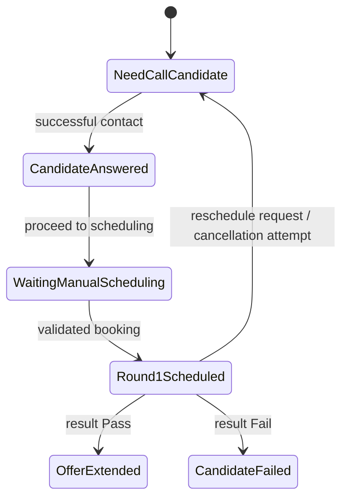
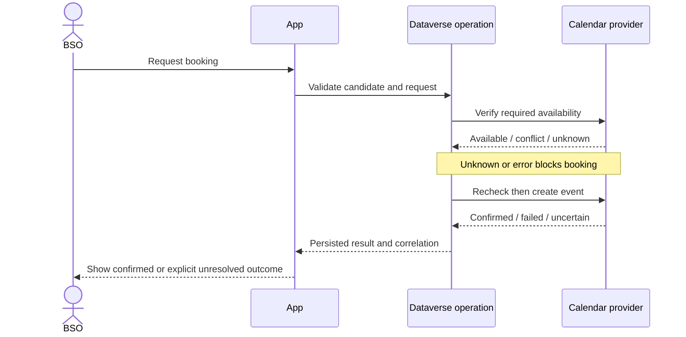

# Business Workflows

**Status:** Core path and safety constraints are confirmed by supplied product context. Screen details, timing, validation fields, and tenant behaviors remain proposed or pending validation. Critical state changes require an approved Dataverse business operation.

## Candidate lifecycle

Status labels use spaces in the application: Need Call Candidate, Candidate Answered, Waiting Manual Scheduling, Round 1 Scheduled, Offer Extended, Candidate Failed. No legacy Submit-to-TA Approval stage is permitted.

## Actors

- **BSO:** primary interactive user and scheduling coordinator; owns the candidate operation and initiates authorized actions.
- **TA:** required interviewer and directory contact. Not automatically an interactive app role or approval actor.
- **Candidate:** required interview attendee; not assumed to have application access.
- **Room:** offline interview resource attendee.
- **System integrations:** execute verified external actions under explicitly designed identities and return observable outcomes.

## Transition rules

Each accepted transition records previous status, new status, actor, timestamp, reason where applicable, and correlation identifier where applicable. Invalid transitions are rejected server-side. Repeated submissions must not create duplicate state changes or history entries. Transition authorization and idempotency details require schema/API design review.

| Transition | Required condition | Failure behavior |
|---|---|---|
| Need Call Candidate → Candidate Answered | BSO records qualifying answered call/outcome | Keep prior status; show actionable validation/error |
| Candidate Answered → Waiting Manual Scheduling | Required candidate and job prerequisites validated; candidate is ready to schedule | Do not advance if CV URL or linked valid LEGO career is absent/invalid under product rules |
| Waiting Manual Scheduling → Round 1 Scheduled | Verified availability and successful, reconciled booking result | Unknown/conflict/error blocks or leaves explicit pending/indeterminate state; never report booked from Flow invocation alone |
| Round 1 Scheduled → Offer Extended | Recorded Pass result through authorized business operation | Reject missing/invalid result; record history |
| Round 1 Scheduled → Candidate Failed | Recorded Fail result through authorized business operation | Reject missing/invalid result; record history |
| Round 1 Scheduled → Need Call Candidate | Reschedule requested; cancellation attempted and outcome audited | Preserve unresolved calendar state for reconciliation; do not imply cancellation succeeded when uncertain |

## Booking sequence (proposed integration contract)

External calendar calls cannot be assumed transactional. Use an idempotency key/correlation and reconciliation before retrying uncertain creation/cancellation.

## Email workflow

Render an approved template into a content snapshot, validate intended BSO identity and logical To/CC, and create one dispatch with unique idempotency key. Record Sent only when evidence supports a sent outcome; record Failed on confirmed failure; Indeterminate on uncertain result. Do not blindly resend Indeterminate dispatches. A Flow starting successfully does not prove delivery.

## LEGO synchronization

Sync from the official proxy using a stable external identifier and idempotent upsert. Show only Vietnam postings for the relevant workflow. Exactly one title match may auto-select; zero/multiple matches require manual resolution. Partial/error responses must not deactivate all valid records. API contract and country semantics require validation.
