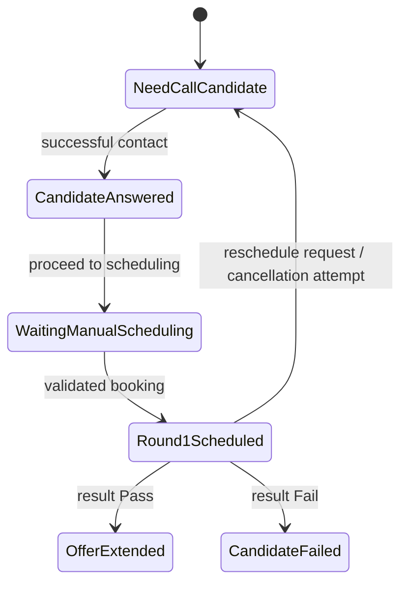
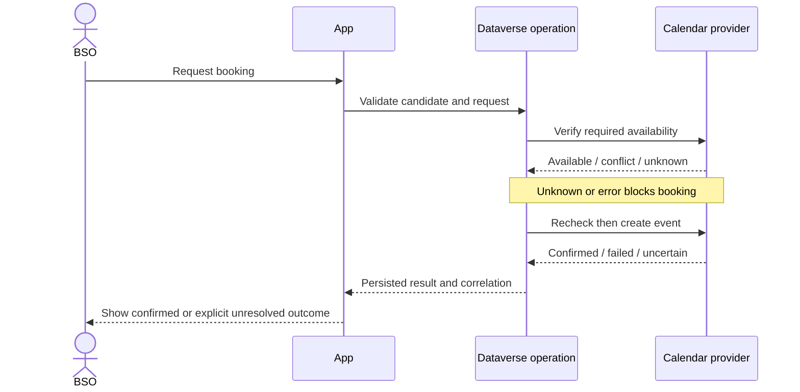

# Business Workflows

**Status:** Core path and safety constraints are confirmed by supplied product context. Screen details, timing, validation fields, and tenant behaviors remain proposed or pending validation. Critical state changes require an approved Dataverse business operation.

## Candidate lifecycle

Status labels use spaces in the application: Need Call Candidate, Candidate Answered, Waiting Manual Scheduling, Round 1 Scheduled, Offer Extended, Candidate Failed. No legacy Submit-to-TA Approval stage is permitted.

## Actors

- **BSO:** primary interactive user and scheduling coordinator; owns the candidate operation and initiates authorized actions.
- **TA:** required interviewer and directory contact. Not automatically an interactive app role or approval actor.
- **Candidate:** required interview attendee; not assumed to have application access.
- **Room:** offline interview resource attendee.
- **System integrations:** execute verified external actions under explicitly designed identities and return observable outcomes.

## Candidate Core owner-approved call and transition rules

For a Candidate in `Need Call Candidate`:

| Call outcome | Call Log | Candidate status | Status History |
|---|---|---|---|
| Answered | Created | Advances to `Candidate Answered` | Exactly one row, atomically with Call Log and Candidate update |
| No Answer | Created | Remains `Need Call Candidate` | None |
| Call Back Requested | Created | Remains `Need Call Candidate` | None |

Only these three outcomes are permitted in the initial Candidate slice. A caller-generated GUID `CorrelationId` is required for every state-changing Candidate operation; retries of the same logical operation must reuse it. Duplicate execution must not create duplicate Call Logs, Status History rows, or status transitions.

Candidate Name and Email are required at creation; Phone is optional. Candidate Number is a server-generated, immutable, unique, nonpersonal identifier. The Dataverse record Owner is the responsible BSO; TA remains a separate interviewer/directory lookup and is not the Candidate owner by default. Candidate core includes Position and defers the LEGO Career lookup until the later scheduling/booking boundary.

## Transition rules

Each accepted transition records previous status, new status, actor, timestamp, reason where applicable, and required operation CorrelationId. Invalid transitions are rejected server-side. Repeated submissions must not create duplicate state changes or history entries. Candidate, Call Log, and Candidate Status History table auditing is required. No column-level security is applied to Candidate Name/Email/Phone in the initial slice; least-privilege table/row access still applies.

| Transition | Required condition | Failure behavior |
|---|---|---|
| Need Call Candidate → Candidate Answered | BSO records outcome `Answered` | Atomically create Call Log + status change + one Status History row; reject/rollback all on failure |
| Need Call Candidate → Need Call Candidate | BSO records `No Answer` or `Call Back Requested` | Create Call Log only; no status change or History row |
| Candidate Answered → Waiting Manual Scheduling | Candidate is ready to enter the manual scheduling queue | Candidate core does not require a LEGO Career lookup; future booking boundary enforces CV URL and valid linked career |
| Waiting Manual Scheduling → Round 1 Scheduled | Verified availability and successful, reconciled booking result | Unknown/conflict/error blocks or leaves explicit pending/indeterminate state; never report booked from Flow invocation alone |
| Round 1 Scheduled → Offer Extended | Recorded Pass result through authorized business operation | Reject missing/invalid result; record history |
| Round 1 Scheduled → Candidate Failed | Recorded Fail result through authorized business operation | Reject missing/invalid result; record history |
| Round 1 Scheduled → Need Call Candidate | Reschedule requested with mandatory reason | History records actor, timestamp, CorrelationId, previous/new status, and reason. Actual cancellation attempt/evidence is deferred to scheduling; keep this action unavailable until that boundary is implemented. |

Initial Candidate status is `Need Call Candidate`; creation does not create a Status History row. Candidate Number is generated by Dataverse and cannot be edited by the caller. Owner is the authenticated initiating BSO. All state-changing actions go through the approved Dataverse operation; caller-generated CorrelationId is required.

## Booking sequence (proposed integration contract)

External calendar calls cannot be assumed transactional. Use an idempotency key/correlation and reconciliation before retrying uncertain creation/cancellation.

## Email workflow

Render an approved template into a content snapshot, validate intended BSO identity and logical To/CC, and create one dispatch with unique idempotency key. Record Sent only when evidence supports a sent outcome; record Failed on confirmed failure; Indeterminate on uncertain result. Do not blindly resend Indeterminate dispatches. A Flow starting successfully does not prove delivery.

## LEGO synchronization

Sync from the official proxy using a stable external identifier and idempotent upsert. Show only Vietnam postings for the relevant workflow. Exactly one title match may auto-select; zero/multiple matches require manual resolution. Partial/error responses must not deactivate all valid records. API contract and country semantics require validation.
