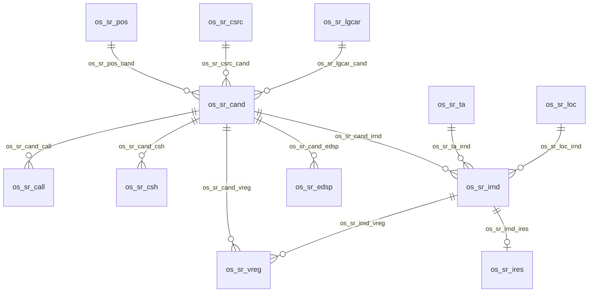

# Proposed Dataverse Data Model

**Status:** Design proposal only. None of these tables, columns, relationships, keys, or publisher settings are deployed. Phase 1A must review schema, ownership, keys, retention, security, and naming before provisioning.

## Naming standard and private abbreviation dictionary

The following internal dictionary maps business meanings to proposed technical abbreviations. Keep this mapping in this repository; do not publish it externally. The project namespace is `os_sr`, and proposed logical names use it as shown below wherever the platform supports it. These names are not approved or deployed.

| Business meaning | Abbreviation | Example proposed table name |
|---|---|---|
| Candidate | `cand` | `os_sr_cand` |
| Call Log | `call` | `os_sr_call` |
| Candidate Status History | `csh` | `os_sr_csh` |
| Interview Round | `irnd` | `os_sr_irnd` |
| Interview Result | `ires` | `os_sr_ires` |
| TA Directory | `ta` | `os_sr_ta` |
| Location | `loc` | `os_sr_loc` |
| Position | `pos` | `os_sr_pos` |
| Candidate Source | `csrc` | `os_sr_csrc` |
| Email Template | `etpl` | `os_sr_etpl` |
| Email Dispatch | `edsp` | `os_sr_edsp` |
| Visitor Registration | `vreg` | `os_sr_vreg` |
| LEGO Career | `lgcar` | `os_sr_lgcar` |
| Integration Run | `irun` | `os_sr_irun` |
| App Configuration | `acfg` | `os_sr_acfg` |

Additional reusable tokens: `cnum` = Candidate Number; `cnak` = Candidate Number alternate key; `stat` = workflow status; `hist` = history; `res` = result; `loc` = location; `cfg` = configuration; `bk` = booking; `int` = interview; `bkint` = book interview; `cal` = calendar; `calbk` = calendar booking; `eml` = email; `sch` = scheduling; `idem` = idempotency; `corid` = correlation ID; `extid` = external ID; `stp` = plug-in step. Use these only where they describe the field or operation precisely; add new abbreviations to this dictionary before use. Avoid personal values or identifying data in every technical name.

Apply the convention consistently to Dataverse tables, custom columns, relationships, alternate keys, Custom APIs, plug-in assemblies/types/steps, and Cloud Flows wherever each platform component supports custom naming. Use lowercase abbreviations and the patterns below; keep user-facing display labels readable business terms.

| Component | Proposed pattern | Example |
|---|---|---|
| Table | `os_sr_<table-abbreviation>` | `os_sr_cand` |
| Custom column | `os_sr_<table-abbreviation>_<field-abbreviation>` | `os_sr_cand_cnum` |
| Relationship | `os_sr_<source-abbreviation>_<target-abbreviation>[_<purpose-abbreviation>]` | `os_sr_cand_call` |
| Alternate key | `os_sr_<table-abbreviation>_<key-abbreviation>` | `os_sr_cand_cnak` |
| Custom API | `os_sr_<operation-abbreviation>` | `os_sr_bkint` (book interview) |
| Plug-in component | `os_sr_<operation-abbreviation>[_<component-role-abbreviation>]` | `os_sr_bkint_stp` |
| Cloud Flow | `os_sr_<process-abbreviation>` | `os_sr_calbk` (calendar booking) |

Platform-generated names, required formats, and system components may not permit these patterns. Validate supported names, length limits, reserved words, uniqueness, relationship/key constraints, and solution publisher behavior in an approved design/validation step before creation; do not invent a substitute namespace. Microsoft documents the Publisher `CustomizationPrefix` field as having a maximum length of eight characters, so `os_sr` meets that length limit. The published reference does not specify whether underscores are accepted in the prefix. Confirm the exact value through the supported publisher validation before schema approval; no tenant validation was performed for this documentation-only change. See [Publisher table reference](https://learn.microsoft.com/en-us/power-apps/developer/data-platform/reference/entities/publisher#customizationprefix) and [solution publisher guidance](https://learn.microsoft.com/en-us/power-platform/alm/solution-concepts-alm#solution-publisher).

Once technical names are approved, keep them stable. Do not rename or recreate an existing component without an explicit migration plan addressing dependencies, data, integrations, and deployment. No existing Dataverse components are claimed in this repository.

Abbreviations are a naming and information-disclosure reduction measure, not a security boundary. Protect sensitive data with Dataverse security roles, record-level access control, column-level security when appropriate, auditing, data loss prevention policies, and least-privilege connector access. Never expose personal data in names, logs, fixtures, or repository documentation.

## Proposed entities

| Business entity | Proposed technical table name | Purpose and key relationships | Ownership / key considerations |
|---|---|---|---|
| Candidate | `os_sr_cand` | Main candidate, contact, candidate number, job/source, status, BSO owner, TA, CV URL, LEGO Career | Candidate Number unique; likely user/team owned, confirm access model |
| Call Log | `os_sr_call` | Append-only outreach outcome, time, actor, notes; N:1 Candidate | Candidate lookup; audit actor/time; restrict edits/deletion per retention decision |
| Candidate Status History | `os_sr_csh` | Previous/new status, actor, timestamp, reason, correlation; N:1 Candidate | Append-only business history; unique transition/action token to reduce duplicates |
| Interview Round | `os_sr_irnd` | Candidate, TA, mode, room, start/end, organizer, provider event ID, status; N:1 Candidate | Event/action correlation unique as applicable; define multiple attempts and time zones |
| Interview Result | `os_sr_ires` | Pass/Fail, feedback, salary, recorded by/at; relationship to Candidate and Round | Enforce one valid result or versioning policy; salary field protection decision |
| TA Directory | `os_sr_ta` | Email, display name, active | Stable directory identifier/email uniqueness; not an interactive user role by default |
| Location | `os_sr_loc` | Name, room/resource email, details, active | Stable location and resource identity; validate room mailbox mapping |
| Position | `os_sr_pos` | Title, active | Decide stable key and duplicate-title handling |
| Candidate Source | `os_sr_csrc` | Source name, active | Decide stable key and whether historical values are retained |
| Email Template | `os_sr_etpl` | Code, subject/body, To/CC defaults, active | Stable code; allowlisted variables; approval/versioning and localization policy |
| Email Dispatch | `os_sr_edsp` | Candidate, idempotency key, intended sender, To/CC, subject/body snapshot, state, provider correlation, timestamps/errors | Idempotency key unique; restrict PII/body access and retention; states Queued/Sending/Sent/Failed/Indeterminate |
| Visitor Registration | `os_sr_vreg` | Candidate, interview, location, visit time, status | Relationship/cardinality and retention require validation |
| LEGO Career | `os_sr_lgcar` | External ID, position/title, location/country, URL, status, last sync | External ID unique; upsert key; avoid deactivation on partial sync |
| Integration Run | `os_sr_irun` | Kind, correlation, start/end, state, sanitized error | Restrict payload/PII; retention and observability policy required |
| App Configuration | `os_sr_acfg` | Logical key and approved nonsecret value | Prefer environment variables for environment-specific settings/secrets; do not store secrets as ordinary rows |

## Relationship sketch

The nodes and relationship labels use proposed abbreviated identifiers; cardinalities are conceptual and need schema review, especially Interview Result, Location, and LEGO Career. Do not treat this diagram as a deployed schema.

## Cross-cutting design questions

Confirm primary names/alternate keys, ownership (user/team/org), row sharing, field-level security for salary and personal details, audit configuration, retention/deletion/archiving, optimistic concurrency, time zone strategy, cascade behavior, duplicate detection, and migration identity keys. Critical status changes should atomically record state/history within an approved server-side operation. External effects remain separately correlated and reconciled.
