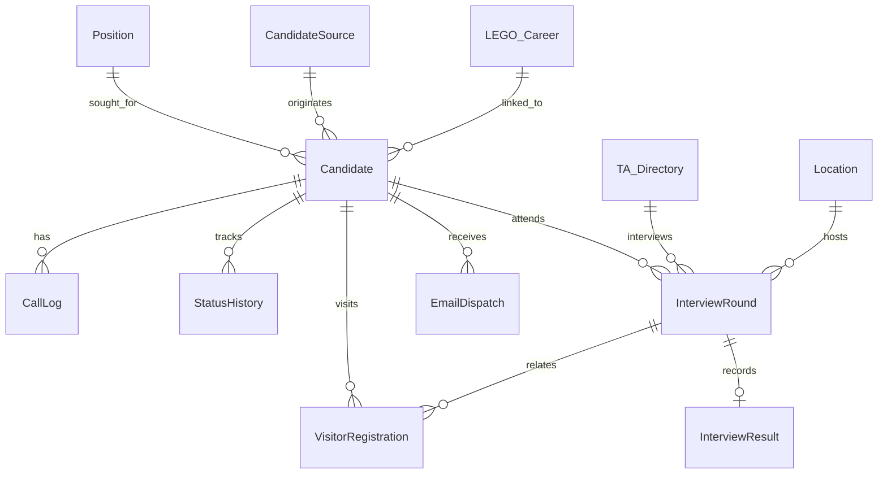

# Proposed Dataverse Data Model

**Status:** Design proposal only. None of these tables, columns, relationships, keys, or publisher settings are deployed. Phase 1A must review schema, ownership, keys, retention, and security before provisioning. Publisher prefix `brs_` is provisional.

## Proposed entities

| Entity | Purpose and key relationships | Ownership / key considerations |
|---|---|---|
| Candidate | Main candidate, contact, candidate number, job/source, status, BSO owner, TA, CV URL, LEGO Career | Candidate Number unique; likely user/team owned, confirm access model |
| Call Log | Append-only outreach outcome, time, actor, notes; N:1 Candidate | Candidate lookup; audit actor/time; restrict edits/deletion per retention decision |
| Candidate Status History | Previous/new status, actor, timestamp, reason, correlation; N:1 Candidate | Append-only business history; unique transition/action token to reduce duplicates |
| Interview Round | Candidate, TA, mode, room, start/end, organizer, provider event ID, status; N:1 Candidate | Event/action correlation unique as applicable; define multiple attempts and time zones |
| Interview Result | Pass/Fail, feedback, salary, recorded by/at; relationship to Candidate and Round | Enforce one valid result or versioning policy; salary field protection decision |
| TA Directory | Email, display name, active | Stable directory identifier/email uniqueness; not an interactive user role by default |
| Location | Name, room/resource email, details, active | Stable location and resource identity; validate room mailbox mapping |
| Position | Title, active | Decide stable key and duplicate-title handling |
| Candidate Source | Source name, active | Decide stable key and whether historical values are retained |
| Email Template | Code, subject/body, To/CC defaults, active | Stable code; allowlisted variables; approval/versioning and localization policy |
| Email Dispatch | Candidate, idempotency key, intended sender, To/CC, subject/body snapshot, state, provider correlation, timestamps/errors | Idempotency key unique; restrict PII/body access and retention; states Queued/Sending/Sent/Failed/Indeterminate |
| Visitor Registration | Candidate, interview, location, visit time, status | Relationship/cardinality and retention require validation |
| LEGO Career | External ID, position/title, location/country, URL, status, last sync | External ID unique; upsert key; avoid deactivation on partial sync |
| Integration Run | Kind, correlation, start/end, state, sanitized error | Restrict payload/PII; retention and observability policy required |
| App Configuration | Logical key and approved nonsecret value | Prefer environment variables for environment-specific settings/secrets; do not store secrets as ordinary rows |

## Relationship sketch

Relationship cardinalities are conceptual and need schema review, especially Interview Result, Location, and LEGO Career. Do not treat this diagram as a deployed schema.

## Cross-cutting design questions

Confirm primary names/alternate keys, ownership (user/team/org), row sharing, field-level security for salary and personal details, audit configuration, retention/deletion/archiving, optimistic concurrency, time zone strategy, cascade behavior, duplicate detection, and migration identity keys. Critical status changes should atomically record state/history within an approved server-side operation. External effects remain separately correlated and reconciled.
