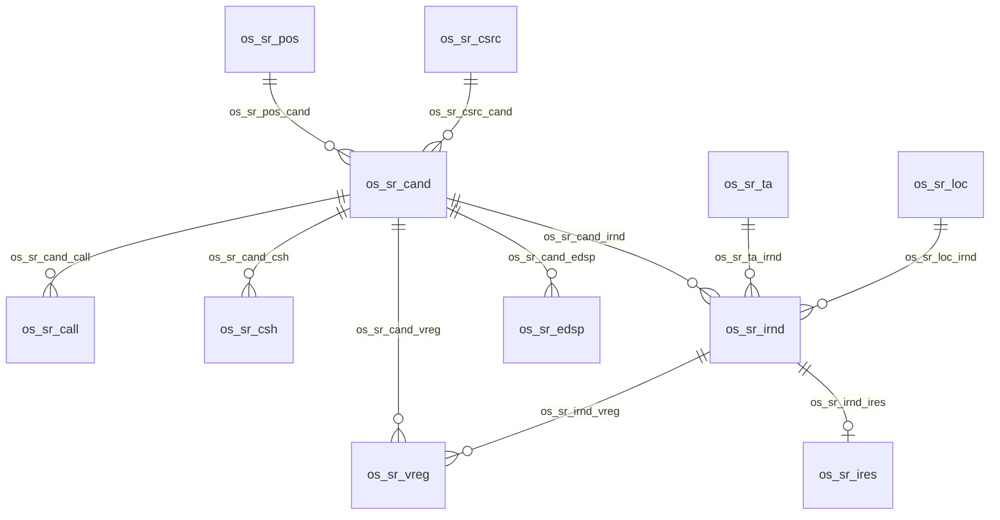

# Proposed Dataverse Data Model

**Status:** The approved TA, Position, Candidate Source, and Location reference-table slices and their approved columns are verified in the existing unmanaged Solution; Location was independently reconciled on 22 October 2026. Candidate, Call Log, and Candidate Status History now reconcile to the approved Candidate Core storage design, including their Choices, relationships, Active keys, ownership, and audit metadata. On 24 October, the owner-authorized replacement deleted/recreated only History fields `os_sr_csh_prevstat` and `os_sr_csh_newstat`, retaining their approved names and other approved properties; both now bind to `os_sr_candstat`. Call Log's outcome field remains correctly bound to `os_sr_callout`. Neither global Choice's labels or integer values changed. History remained empty, and no business data or publication write occurred in that metadata operation. Current outcome is `CANDIDATE_CORE_STORAGE_PROVISIONED_AUDIT_ACTIVATION_PENDING`; the earlier wrong bindings and unsuccessful in-place update are historical. The local primary-name contract remains `MaxLength=100`, Text, with unchanged approved AutoNumber formats. Organization-level auditing remains disabled; the Candidate Core production backend and its least-privilege Custom API execution remain external security gates. The separate Phase 4A-4E UI is a synthetic-only DEV direct-write fallback, not production authority or approval to use real data. See the [Phase 3B.2 report](PHASE_3B2_CANDIDATE_CHILD_TABLES_REPORT.md), [Candidate-only provisioning report](PHASE_3A_CANDIDATE_TABLE_PROVISIONING_REPORT.md), [Phase 3A](PHASE_3A_CANDIDATE_CORE_DESIGN.md), and [Current State](CURRENT_STATE.md). The wider Phase 1C design remains a proposal in [Dataverse Schema Specification](DATAVERSE_SCHEMA_SPECIFICATION.md).

## Verified TA Implementation

| Item | Verified metadata, 19 October 2026 |
|---|---|
| Table | `os_sr_ta`; **TA Directory**; plural **TA Directories** (owner-approved) |
| Ownership | `OrganizationOwned` |
| Primary GUID | `os_sr_taid`; `Uniqueidentifier`; `IsPrimaryId=true` |
| Primary name | `os_sr_ta_nm`; **TA Name**; String/Text; max 200; `ApplicationRequired`; `IsPrimaryName=true` |
| Email | `os_sr_ta_eml`; **TA Email**; String/Email; max 254; `ApplicationRequired` |
| Platform state | Standard `statecode` and `statuscode`; no custom `is_active` |
| Keys and relationships | No alternate keys or user-defined relationships created |
| Solution | `os_sr_bso_rs_support`, unmanaged `1.0.0.0`; table root `rootcomponentbehavior=0` includes subcomponents |
| Audit and data | Table audit flag false; environment auditing, retention, and user-access auditing unchanged; no business-row operations issued |

Creation used Dataverse Web API metadata requests with the approved Solution header. Independent metadata reads passed after correcting a local membership-verifier false negative; Apply was not retried. This confirms schema creation only, not app usability, business-data quality, security-role acceptance, or audit-policy approval.

## Verified Location Implementation

| Item | Verified metadata, 22 October 2026 |
|---|---|
| Table | `os_sr_loc`; **Location**; plural **Locations** |
| Ownership | `OrganizationOwned` |
| Primary GUID | `os_sr_locid`; `Uniqueidentifier`; primary ID |
| Primary name | `os_sr_loc_nm`; **Location Name**; String/Text; max 150; `ApplicationRequired`; primary name |
| Room/resource email | `os_sr_loc_rmeml`; **Room/Resource Email**; String/Email; max 254; optional |
| Details | `os_sr_loc_det`; **Location Details**; Memo/Text; max 1,000; optional |
| Keys and relationships | No alternate keys or custom relationships |
| Solution and publication | `os_sr_bso_rs_support`, unmanaged; membership verified; `PUBLISHED_NO_PENDING_DELTA` |
| Audit and data | Table audit flag false; audit settings unchanged; no business records created |

The table and two additional attributes were created in the separately authorized Sprint 02F.3 bounded operation. Each write was reconciled by Strong-consistency GET before the next step; the final exact-schema, inventory, membership, audit, and publication checks passed. No `PublishXml`, PATCH, DELETE, or retry was sent. This confirms metadata only, not application usability, business-data quality, security-role acceptance, or audit-policy approval; see [Current State](CURRENT_STATE.md).

## Verified Round 1 Interview Schedule DEV Table

The `os_sr_intv` table was provisioned in VN LMV IT for the separately authorized Phase 4C synthetic DEV workflow and extended for the Phase 4D DEV result slice; it is a root component in `os_sr_bso_rs_support`. This is not approval of the wider production scheduling, availability, calendar-booking, reschedule, or interview-result design.

| Item | Verified metadata, 28 October 2026 |
|---|---|
| Table | `os_sr_intv`; **Interview Schedule**; plural **Interview Schedules** |
| Ownership | `UserOwned` |
| Primary ID / primary name | `os_sr_intvid`; required AutoNumber Text `os_sr_intv_ref`, format `INTV-{SEQNUM:8}`, max 100 |
| Round | Required local Choice `os_sr_intv_rnd`; only `Round 1`, value `100000000` |
| Times | Required User Local Date/Time `os_sr_intv_strt` and `os_sr_intv_end`; the UI requires explicit Start and End on the same date |
| Notes | Optional Memo `os_sr_intv_nts`, max 1,000 |
| Interview result | Optional local Choice `os_sr_intv_res`; Pending `100000000`, Pass `100000001`, Fail `100000002` |
| Result timestamp / notes | Optional User Local Date/Time `os_sr_intv_recat`; optional Memo `os_sr_intv_rnts`, max 1,000 |
| Schedule lifecycle | Optional local Choice `os_sr_intv_stat`: Proposed `100000000`, Scheduled `100000001`, Cancelled `100000002`, Superseded `100000003` |
| Cancellation/reschedule evidence | Optional Memo `os_sr_intv_rsn` for required action reason; optional User Local Date/Time `os_sr_intv_chg` for lifecycle change time |
| Required lookups | Candidate `os_sr_intv_cand`, TA `os_sr_intv_ta`, Location `os_sr_intv_loc` |
| Relationships | `os_sr_cand_intv`, `os_sr_ta_intv`, `os_sr_loc_intv`; parent-to-many, Delete Restrict, assignment/sharing/reparent cascades disabled |
| Audit / Solution | Table audit metadata enabled; root component in unmanaged `os_sr_bso_rs_support`. Organization-level auditing remains unchanged and disabled. |
| Scope exclusions | No offer or calendar columns; no Round 2 or scorecard model |

The live schema was reconciled after Phase 4C, 4D, and 4E provisioning. Legacy rows with an unset lifecycle Choice are treated as Scheduled for backward compatibility. A reschedule marks the prior row Superseded and creates a Proposed replacement; only after re-contact and explicit reconfirmation is that replacement promoted to Scheduled. Cancellation marks the existing row Cancelled. Both operations preserve all rows and use the reason and lifecycle timestamp fields; no schedule deletion is used.

Phase 4D browser acceptance verified Pass and Fail persistence after a full reload on replacement synthetic Candidates `CAND-00001021` and `CAND-00001022`, including the terminal Candidate status and matching Status History. The two initial fixtures (`CAND-00001019` and `CAND-00001020`) retain persisted Pass/Fail results but remain `Round 1 Scheduled` without terminal history after readback warnings; they were not retried or compensated. Live aggregate readback across all four Phase 4D fixtures is Candidate / Call Log / Status History / Interview Schedule / Receipt = **4 / 4 / 14 / 4 / 0**; the two successful branches alone are **2 / 2 / 8 / 2 / 0**.

Phase 4E browser acceptance used synthetic Candidates `CAND-00001023` and `CAND-00001024`. The reschedule branch preserved a Superseded row and a reconfirmed Scheduled row after re-contact; the cancellation branch preserved a Cancelled row. Full reloads showed the schedule history, reasons/timestamps, Candidate states, and Status History. Acceptance-scope readback for those two Candidates is Candidate / Call Log / Status History / Interview Schedule / Receipt = **2 / 3 / 11 / 3 / 0**. See [Current State](CURRENT_STATE.md) and the [Candidate UI implementation note](CANDIDATE_UI_IMPLEMENTATION_NOTE.md).

## P0 Slice 2 calendar extensions (PROPOSED / ARCHITECTURE APPROVED; offline source only)

**Latest independently verified DEV state (2026-11-05):** the complete `os_sr_avq` schema and both TA/Location relationships now match the contract below. Metadata plus entity-root Include Subcomponents plus actual unmanaged export proves all 15 schema children. After a separately authorized completion, the classification is `P0_SLICE_2A_INFRASTRUCTURE_PROVISIONED` for DEV infrastructure only. The four SharePoint defaults were removed from the unassigned integration role, and seven value-less `os_sr_avq_*` variable definitions were created. Only the `os_sr_avq` entity was published. No runtime or guard-deployment acceptance is claimed. See the [execution report](P0_SLICE_2A_DEV_PROVISIONING_REPORT.md). Earlier unverified partial-state notes below describe the previous offline checkpoint.

**Concurrent DEV report (2026-11-05; unverified in this offline session):** the [stop report](P0_SLICE_2A_DEV_PROVISIONING_REPORT.md) states that bounded provisioning stopped at `P0_SLICE_2A_RECONCILIATION_FAILED:MEMBERSHIP:10` after creating the primary name, nonlookup fields and required TA lookup/relationship, but not the Location lookup/relationship. It reports no role/configuration/publication step, an export including the TA relationship under the entity root, and no retry or repair after the explicit-row membership assertion. The contract below remains the complete target, not a complete live-schema claim. Do not infer total absence or continue provisioning without separate verification and approval.

**Status (2026-11-05):** The owner-approved Slice 2A DEV path is Office 365 Outlook `Find meeting times (V2)` as documented in [Product Decisions](PRODUCT_DECISIONS.md#p0-slice-2-calendar-integration-proposed--architecture-approved). The canonical offline schema contract is [AvailabilityQuery.schema.json](../solutions/Entities/os_sr_avq/AvailabilityQuery.schema.json); it is not a Dataverse export, and the Outlook refactor changes no schema fields or relationships. A concurrent [stop report](P0_SLICE_2A_DEV_PROVISIONING_REPORT.md) describes partial table/TA-relationship creation, unverified in this offline session. No metadata or tenant write is authorized here. The user-approved 30-day retention policy is documented; cleanup is not implemented. See [Integration Design](INTEGRATION_DESIGN.md#p0-slice-2-calendar-availability-and-booking-proposed--architecture-approved) and [Current State](CURRENT_STATE.md).

**Existing fields Slice 2 relies on (verified above):** `os_sr_ta_eml` (required String/Email, max 254) is the TA free/busy and attendee address; `os_sr_loc_rmeml` (optional String/Email, max 254) is the room/resource mailbox address. TA rows need not correspond to Dataverse users. Neither email is validated against Exchange today; Slice 2A validates syntax and allowed domain before the Outlook call and treats provider errors as unknown availability.

### Slice 2A: Availability Query `os_sr_avq`

A transient integration row; the flow runs asynchronously, so the Console creates a request row and polls its result. It has **no Candidate or `os_sr_intv` lookup** and is never read by Candidate Core.

| Approved offline field contract | Type | Purpose |
|---|---|---|
| `os_sr_avq_ref` | AutoNumber Text, `AVQ-{SEQNUM:8}`, primary name | Nonpersonal reference |
| `os_sr_avq_ta` | Lookup TA Directory, required | Source of TA address |
| `os_sr_avq_loc` | Lookup Location, optional | Required by the plug-in when mode is Onsite |
| `os_sr_avq_mod` | Choice: Online / Onsite | Required sources |
| `os_sr_avq_strt` / `os_sr_avq_end` | DateTime UTC | Requested window |
| `os_sr_avq_dur` | Whole number (minutes) | Requested slot length |
| `os_sr_avq_stat` | Choice: Pending / Available / NoSlots / Failed | Displayed result state |
| `os_sr_avq_rsn` | String(40) | Deterministic NoSlots reason code |
| `os_sr_avq_err` | String(40) | Safe deterministic failure category (e.g. `TA_INACTIVE`, `ROOM_EMAIL_MISSING`, `PROVIDER_RESPONSE_INVALID`, `PROVIDER_TIMEZONE_UNSUPPORTED`, `PROVIDER_AUTH`, `PROVIDER_TIMEOUT`, `MAILBOX_NOT_FOUND`, `REFERENCE_CHANGED`) |
| `os_sr_avq_slts` | Memo (JSON) | Computed valid slots only |
| `os_sr_avq_qat` / `os_sr_avq_exp` | DateTime UTC | Queried-at and expiry |

Provider responses, attendee availability and mailbox addresses are **not** persisted. `os_sr_avq_slts` contains only bounded, sorted, distinct UTC `startUtc`/`endUtc` objects. The separate `os_sr_avqg.ProtectAvailabilityQuery` source lets the separate BSO requester create Pending rows only and lets only the configured DEV owner result-writer identity write one terminal result. `DEV_FUNCTIONAL_IDENTITY_ELEVATED_NOT_SECURITY_ACCEPTANCE`; Production identity remains a later decision. Retention is 30 days; a bounded daily cleanup design exists but is not deployed or run. See the [offline source](../solutions/AvailabilityQuery/).

The Flow retains reference IDs, active states and normalized mailbox addresses in memory only, then re-reads required TA/Location immediately before every terminal write. Relevant drift or an unreadable reference yields Failed / `REFERENCE_CHANGED` / `[]` slots; display-name changes do not invalidate. No snapshot column or schema change is added. See [Integration Design](INTEGRATION_DESIGN.md#slice-2a-availability-algorithm).

### Slice 2B+: proposed `os_sr_intv` additions

| Proposed field | Type | Lifecycle reason |
|---|---|---|
| `os_sr_intv_mod` | Choice: Online / Onsite | Required availability sources; whether Teams is created |
| `os_sr_intv_bkst`† | Choice: booking state; empty = manual/legacy | External lifecycle, separate from `os_sr_intv_stat` |
| `os_sr_intv_idem` | String(36), unique key | Booking GUID = `transactionId` = extended-property value |
| `os_sr_intv_orgeml` | Email | Organizer mailbox snapshot |
| `os_sr_intv_evt` | String(512) | Immutable event id for get/cancel |
| `os_sr_intv_ical`† | String(512) | Correlate organizer, attendee, and room copies |
| `os_sr_intv_ckey`† | String(100) | Detect manual Outlook edits before cancel |
| `os_sr_intv_atsn`† | Memo (JSON) | Snapshot of invited TA, room, candidate addresses |
| `os_sr_intv_avat`† / `os_sr_intv_bkat`† / `os_sr_intv_xcxat`† | DateTime UTC | Final recheck passed / booking confirmed / external cancel confirmed |
| `os_sr_intv_err` | String(40) | Sanitized failure code |
| `os_sr_intv_lsync` | DateTime UTC | Last reconciliation |
| `os_sr_intv_join`† | URL (2C only) | Teams join URL; credential-like, restrict read or do not store |

Also proposed for 2B: Choice value `Withdrawn` on `os_sr_intv_stat` for a Proposed row whose booking definitely did not occur (Cancelled stays reserved for the business cancel action), and relaxing `os_sr_intv_loc` to optional with the Onsite rule enforced in the plug-in (D7). No tokens, secrets, or connection credentials are stored in any field.

Approved Slice 2A dictionary additions: `avq` = Availability Query; `dur` = duration; `slts` = computed slots; `qat` = queried at; `exp` = expires at; `bhrs` = business hours; `durs` = allowed durations; `lead` = lead time; `hzn` = horizon; `dom` = allowed email domain; `avqg` = availability-query guard; `avchk` = availability check; `cr` = connection reference; `avqint` = Availability Integration. These names do not imply provisioned components. Technical Lead approved `maxc` = Maximum Candidates and `os_sr_avq_maxc` on 2026-11-05; its offline bound is 1-200 and the live definition remains absent at the continuation stop. Slice 2B+ tokens `bkst`, `ical`, `ckey`, `atsn`, `avat`, `bkat`, `xcxat`, and `join` remain proposals.

## Naming standard and private abbreviation dictionary

### Verified Phase 3C Operation Receipt

Owner-approved 24 October 2026 as minimal replay infrastructure, not an end-user navigation table. Table `os_sr_oprc` is UserOwned and audit-enabled. String primary name `os_sr_oprc_nm` is required, max 36; server supplies canonical nonpersonal correlation identity. Required String(36) `os_sr_oprc_corid` has Active unique key `os_sr_oprc_ak_corid`. No GUID-typed alternate-key field is used.

Other required fields: `os_sr_oprc_cact` String(40), `os_sr_oprc_hash` String(64), `os_sr_oprc_ver` String(10), `os_sr_oprc_newstat` Integer, and audited Candidate lookup `os_sr_oprc_cand`. Optional fields: `os_sr_oprc_prevstat` Integer, `os_sr_oprc_callref` / `os_sr_oprc_histref` String(36) result references. Relationship `os_sr_cand_oprc` has Delete Restrict and no assign/share/unshare/reparent/merge cascades. The bounded SYSTEM service owns and creates this infrastructure Receipt; actor identity is bound by the canonical request fingerprint, not Receipt ownership or `createdby`. Candidate ownership and explicit business actor fields remain caller-attributed. No raw contact/request payload is stored.

The approved receipt schema/API contracts and implementation semantics are in [receipt plan](PHASE_3C_OPERATION_RECEIPT_PLAN.json), [API contract](PHASE_3C_API_CONTRACT.json), and [Phase 3C report](PHASE_3C_CANDIDATE_CORE_API_PLUGIN_REPORT.md). Server guards enforce API-only append and immutable evidence; no user/team role grants, receipt navigation, or retention purge were introduced. Organization-level auditing remains externally pending. Existing Candidate/Call/History attributes and Choices were not changed.

Receipt dictionary additions: `oprc` = Operation Receipt; `hash` = normalized request fingerprint; `callref` = original Call Log result GUID reference; `histref` = original Status History result GUID reference. Existing `cact`, `corid`, `ver`, `nm`, `cand`, `prevstat`/`newstat`, and `ak` tokens are reused. Assembly name/namespace is `os_sr_cact`; .NET type names use descriptive suffixes `ApplyCandidateAction` and `ProtectCandidateCore` within that namespace rather than inventing new table prefixes.

The following internal dictionary maps business meanings to technical abbreviations. Keep this mapping in this repository; do not publish it externally. The selected naming strategy is Publisher Prefix `os` plus the project namespace segment `sr_`. Together they form the final technical-name prefix `os_sr_`; examples below show final names, not values to paste blindly into auto-prefixing name fields. The verified implementations are described in the sections above; names not identified there remain proposals.

| Business meaning | Abbreviation | Example table name |
|---|---|---|
| Candidate | `cand` | `os_sr_cand` |
| Call Log | `call` | `os_sr_call` |
| Candidate Status History | `csh` | `os_sr_csh` |
| Operation Receipt | `oprc` | `os_sr_oprc` |
| Interview Schedule | `intv` | `os_sr_intv` |
| Interview Round | `irnd` | `os_sr_irnd` |
| Interview Result | `ires` | `os_sr_ires` |
| TA Directory | `ta` | `os_sr_ta` |
| Location | `loc` | `os_sr_loc` |
| Position | `pos` | `os_sr_pos` |
| Candidate Source | `csrc` | `os_sr_csrc` |
| Email Template | `etpl` | `os_sr_etpl` |
| Email Dispatch | `edsp` | `os_sr_edsp` |
| Visitor Registration | `vreg` | `os_sr_vreg` |
| LEGO Career | `lgcar` | `os_sr_lgcar` |
| Integration Run | `irun` | `os_sr_irun` |
| App Configuration | `acfg` | `os_sr_acfg` |

Additional reusable tokens: `cnum` = Candidate Number; `cnak` = Candidate Number alternate key; `stat` = workflow status; `hist` = history; `res` = result; `loc` = location; `cfg` = configuration; `bk` = booking; `int` = interview; `bkint` = book interview; `cact` = Candidate Action (Phase 3A proposal only); `cal` = calendar; `calbk` = calendar booking; `eml` = email; `sch` = scheduling; `idem` = idempotency; `corid` = correlation ID; `extid` = external ID; `stp` = plug-in step; `usr` = Dataverse system user (`systemuser`). Use these only where they describe the field or operation precisely; add new abbreviations to this dictionary before use. Avoid personal values or identifying data in every technical name.

The detailed proposal extends the dictionary with `candstat` = shared Candidate Workflow Status choice; `callout` = Call Outcome choice; `ak` = alternate key; `nm` = name; `ttl` = title; `phn` = phone; `det` = details; `key` = configuration key; `val` = value; `dsc` = description; `out` = outcome; `ctat` = contacted at; `ctby` = contacted by; `nts` = notes; `actr` = actor; `actkey` = action key; `prevstat`/`newstat` = previous/new status; `chg` = changed at; `rsn` = reason; `mod` = mode; `strt`/`end` = start/end; `orgeml` = organizer email; `evt` = provider event; `fb` = feedback; `sal` = salary; `recby`/`recat` = recorded by/at; `ver`/`tplver` = version/template version; `subj`/`body` = subject/body; `tosn`/`ccsn` = To/CC snapshots; `sndr`/`sndas` = intended/observed sender; `sentat`/`tryat` = sent/last-attempt time; `prvid` = provider ID; `err` = sanitized error; `reqby` = requested by; `visat` = visit at; `ctry` = country; `lsync` = last sync; `knd` = kind; `stgat`/`cmpat` = started/completed at; `rowcnt` = row count; `ref` = nonpersonal autonumber reference; `corid` = caller-generated operation CorrelationId. These remain technical tokens, not business requirements.

For the authorized Phase 3B.2 child schema, the parent-to-child relationship names are `os_sr_usr_call_ctby` (System User → Call Log, Contacted By) and `os_sr_usr_csh_actr` (System User → Candidate Status History, Actor). Both preserve the existing lookup names and use `usr` for the standard `systemuser` table; Delete is Restrict and assign/share/reparent cascades are disabled. These are approved implementation names, not additional business relationships.

Apply the convention consistently to Dataverse tables, custom columns, relationships, alternate keys, Custom APIs, plug-in assemblies/types/steps, and Cloud Flows wherever each platform component supports custom naming. Use lowercase abbreviations and the patterns below; keep user-facing display labels readable business terms.

| Component | Proposed final technical-name pattern | Example final name |
|---|---|---|
| Table | `os_sr_<table-abbreviation>` | `os_sr_cand` |
| Custom column | `os_sr_<table-abbreviation>_<field-abbreviation>` | `os_sr_cand_cnum` |
| Relationship | `os_sr_<source-abbreviation>_<target-abbreviation>[_<purpose-abbreviation>]` | `os_sr_cand_call` |
| Alternate key | `os_sr_<table-abbreviation>_<key-abbreviation>` | `os_sr_cand_cnak` |
| Custom API | `os_sr_<operation-abbreviation>` | `os_sr_bkint` (book interview) |
| Plug-in component | `os_sr_<operation-abbreviation>[_<component-role-abbreviation>]` | `os_sr_bkint_stp` |
| Cloud Flow | `os_sr_<process-abbreviation>` | `os_sr_calbk` (calendar booking) |
| Global Choice | `os_sr_<choice-abbreviation>` | `os_sr_candstat` |

For Dataverse components whose Maker experience automatically applies the solution publisher prefix `os`, use only the `sr_<abbreviation>` stem in the name input so the resulting persisted name is `os_sr_<abbreviation>`. For programmatic metadata or other component fields that require a complete logical/schema/unique name, supply the final `os_sr_<abbreviation>` once. Inspect the resulting name before saving; do not enter the full final name into a field that will prepend `os_` and create `os_os_sr_...`.

The five table examples above use lowercase letters and underscores, begin with a letter, and are final names rather than publisher-prefix values. Microsoft documents the customization prefix as 2–8 alphanumeric characters, beginning with a letter; it also says the prefix cannot start with `mscrm`. `os` meets these documented character and length rules. A read-only publisher metadata check in VN LMV IT on 19 October 2026 found no publisher using prefix `os`; this is a time-bound conflict check, not approval or creation evidence. See [Customize Table Definitions](https://learn.microsoft.com/en-us/power-apps/developer/data-platform/customize-entity-metadata), [Publisher table reference](https://learn.microsoft.com/en-us/power-apps/developer/data-platform/reference/entities/publisher), and [solution publisher guidance](https://learn.microsoft.com/en-us/power-platform/alm/solution-concepts-alm#solution-publisher).

Some names cannot or should not follow the final-name pattern. The Publisher `CustomizationPrefix` is `os` by design, not an `os_sr_` component name. Platform-assigned GUIDs, immutable IDs, and system-owned names are not custom names and cannot be forced to begin `os_sr_`. Some primary-column and relationship names may be generated or constrained by their parent metadata; inspect their resulting schema names instead of assuming a free-form suffix. Cloud Flow IDs are platform-assigned, while a user-settable Flow display name should use the full `os_sr_...` form because it does not rely on Dataverse publisher auto-prefixing. Plug-in assembly/type/step names also need component-specific handling; use the full final form where the registration/build tool permits a custom name, and do not assume `os_` will be inserted. Validate each component type's actual name field, allowed characters, length, reserved words, uniqueness, relationship/key constraints, and generated result before creation. If a platform-controlled name cannot follow the convention, document the exception rather than renaming a generated object or silently changing the namespace.

Once technical names are approved, keep them stable. Do not rename or recreate an existing component without an explicit migration plan addressing dependencies, data, integrations, and deployment. The Publisher/Solution setup is recorded in [ALM and Deployment](ALM_DEPLOYMENT.md); the verified TA implementation above is the only deployed project table.

Abbreviations are a naming and information-disclosure reduction measure, not a security boundary. Protect sensitive data with Dataverse security roles, record-level access control, column-level security when appropriate, auditing, data loss prevention policies, and least-privilege connector access. Never expose personal data in names, logs, fixtures, or repository documentation.

## Proposed entities

The per-table implementation proposal, including full column inventory, requiredness, defaults, validation, keys, relationships, delete behavior, ownership, auditing, security, dependencies, and migration mapping, is maintained in [Dataverse Schema Specification](DATAVERSE_SCHEMA_SPECIFICATION.md). The owner-approved Phase 3A Candidate-core decisions and remaining external gates are recorded in [the design report](PHASE_3A_CANDIDATE_CORE_DESIGN.md), [decision application report](PHASE_3A2_CANDIDATE_CORE_DECISION_APPLICATION.md), and [synthetic metadata plan](PHASE_3A_CANDIDATE_CORE_METADATA_PLAN.json). The exact first-four reference table sequence, Maker input stems, solution checks, and recovery plan are in [Phase 1D-B Reference Table Runbook](PHASE_1D_B_REFERENCE_TABLE_RUNBOOK.md). This overview and its abbreviation dictionary remain authoritative for business abbreviations.

| Business entity | Proposed technical table name | Purpose and key relationships | Ownership / key considerations |
|---|---|---|---|
| Candidate | `os_sr_cand` | Candidate Number, required Name/Email, optional Phone, Position/source, status, Dataverse Owner (responsible BSO), TA, later booking fields | UserOwned; Candidate Number is server-generated, immutable, nonpersonal, and unique; no duplicate Assigned BSO or Candidate-to-LEGO-Career lookup |
| Call Log | `os_sr_call` | Append-only controlled outcome, time, actor, notes; N:1 Candidate | Owner-approved outcomes; GUID CorrelationId is the operation/idempotency key; table auditing required |
| Candidate Status History | `os_sr_csh` | Previous/new status, actor, timestamp, mandatory reschedule reason, CorrelationId; N:1 Candidate | Append-only business history; unique Candidate + CorrelationId key; table auditing required |
| Candidate Workflow Status | Global Choice `os_sr_candstat` | Six canonical workflow statuses | Stable option values; verify publisher allocation before provisioning |
| Call Outcome | Global Choice `os_sr_callout` | Answered, No Answer, Call Back Requested | Provisioned and GET-reconciled: 100010000, 100010001, 100010002; frozen in the Phase 3A manifest |
| Interview Round | `os_sr_irnd` | Candidate, TA, mode, room, start/end, organizer, provider event ID, status; N:1 Candidate | Event/action correlation unique as applicable; define multiple attempts and time zones |
| Interview Result | `os_sr_ires` | Pass/Fail, feedback, salary, recorded by/at; relationship to Candidate and Round | Enforce one valid result or versioning policy; salary field protection decision |
| TA Directory | `os_sr_ta` | Email, display name, active | Stable directory identifier/email uniqueness; not an interactive user role by default |
| Location | `os_sr_loc` | Name, room/resource email, details, active | Stable location and resource identity; validate room mailbox mapping |
| Position | `os_sr_pos` | Title, active | Decide stable key and duplicate-title handling |
| Candidate Source | `os_sr_csrc` | Source name, active | Decide stable key and whether historical values are retained |
| Email Template | `os_sr_etpl` | Code, subject/body, To/CC defaults, active | Stable code; allowlisted variables; approval/versioning and localization policy |
| Email Dispatch | `os_sr_edsp` | Candidate, idempotency key, intended sender, To/CC, subject/body snapshot, state, provider correlation, timestamps/errors | Idempotency key unique; restrict PII/body access and retention; states Queued/Sending/Sent/Failed/Indeterminate |
| Visitor Registration | `os_sr_vreg` | Candidate, interview, location, visit time, status | Relationship/cardinality and retention require validation |
| LEGO Career | `os_sr_lgcar` | External ID, position/title, location/country, URL, status, last sync | External ID unique; upsert key; avoid deactivation on partial sync |
| Integration Run | `os_sr_irun` | Kind, correlation, start/end, state, sanitized error | Restrict payload/PII; retention and observability policy required |
| App Configuration | `os_sr_acfg` | Logical key and approved nonsecret value | Prefer environment variables for environment-specific settings/secrets; do not store secrets as ordinary rows |

## Relationship sketch

The nodes and relationship labels use proposed abbreviated identifiers; cardinalities are conceptual and need schema review, especially Interview Result and Location. LEGO Career linking is deferred to the later scheduling/booking boundary and is not a Candidate-core relationship. Do not treat this diagram as a deployed schema.

## Cross-cutting design questions

Confirm primary names/alternate keys, ownership (user/team/org), row sharing, field-level security for salary and personal details, audit configuration, retention/deletion/archiving, optimistic concurrency, time zone strategy, cascade behavior, duplicate detection, and migration identity keys. Critical status changes should atomically record state/history within an approved server-side operation. External effects remain separately correlated and reconciled.
